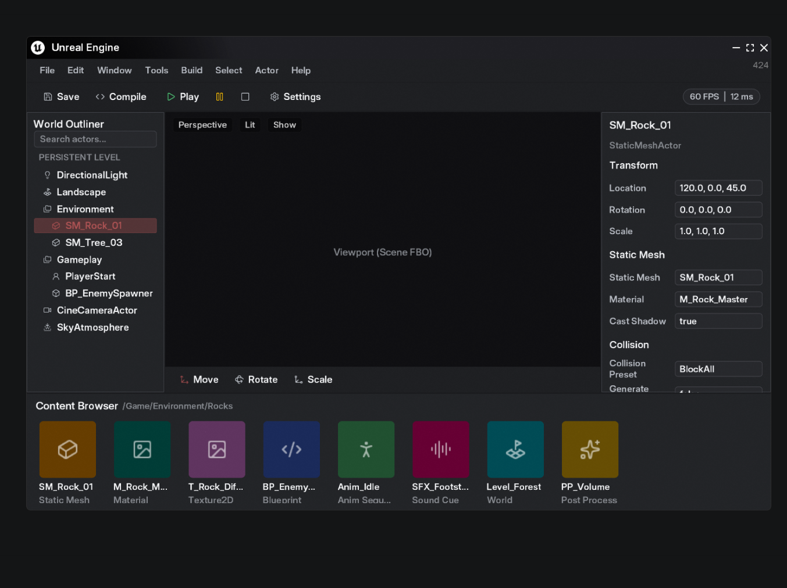
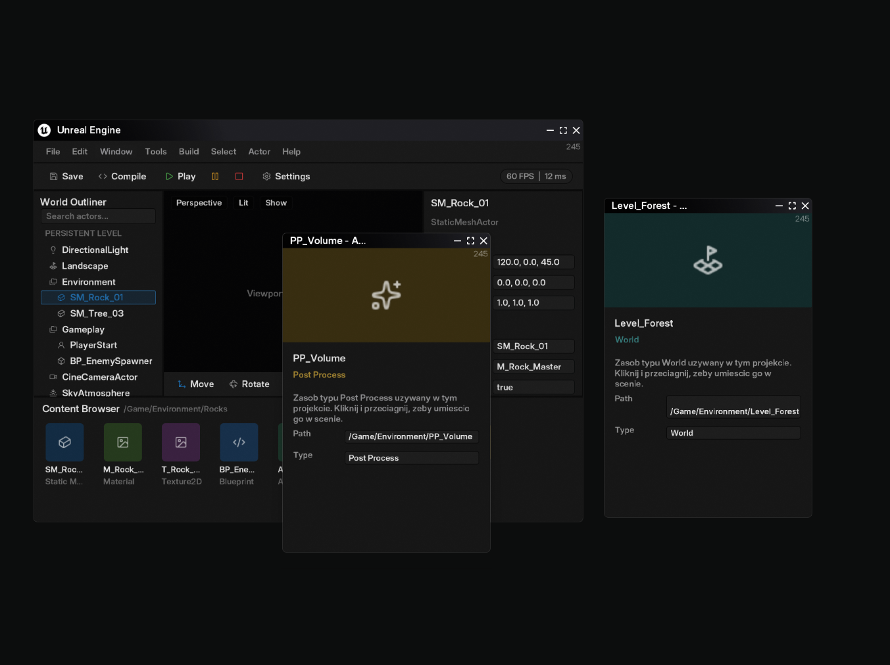

# UI Framework

**UI Framework** is a custom retained-mode UI toolkit written in C++ and OpenGL - built from scratch with its own widget tree, layout engine, SDF text renderer, styling and animation system, input handling and multi-window support.


---

## Highlights

- Widget hierarchy with a two-pass **Measure / Layout / Render** pipeline
- `Fixed`, `Fill` and `Auto` sizing mixed freely inside `VStack` / `HStack`
- Crisp, smooth text rendering using **SDF font atlases**
- Style system with per-state overrides (`Initial` / `Hover` / `Pressed` / `Focused`) and animated transitions
- Central input system with z-order aware hit-testing
- Drag and drop with drop targets and drag-over callbacks
- `ScrollView` with scissor clipping and off-screen culling
- Fragment shader effects: radial gradients, grain, rounded corners, borders
- Multiple windows with custom titlebars
- Grid-packed icon atlases

---

## Screenshots

### Apple Music-style player


### Unreal Editor-style layout



### Multi-window demo with custom titlebars



---

## What I Built

### Widget Tree & Layout

Every UI element is a `Widget` in a tree. Layout runs in two passes: `Measure` calculates desired sizes bottom-up, then `Layout` assigns final positions top-down. Containers like `VStack` and `HStack` distribute space between `Fixed`, `Fill` and `Auto` children, so a single row can mix a fill-width card with a 280px fixed sidebar.

### Composite Widgets

Custom widgets inherit from `Border` (which already handles child recursion for `Measure` / `Layout` / `Render` / `Update`) and build their internals in `Init()`. Construction is two-phase through a `CreateWidget<T>()` factory, which avoids calling virtual functions from constructors.

### Text Rendering

Fonts are rasterized with `stb_truetype`, converted to a single-channel signed distance field using an exact Felzenszwalb-Huttenlocher distance transform, and rendered with an SDF shader. Atlases and glyph metadata are baked offline by a separate tool, **FontKit**, and cached to disk instead of being regenerated on every run.

### Style & Animation System

Each widget holds a map of `Status -> Style`. A `Style` is a struct of `std::optional` fields, so state overrides can be partial and fall back to `Initial`. Every frame `Update(deltaTime)` resolves the target style for the active state and lerps the current animated values toward it - `Render` only reads the animated values.

### Input & Hit-Testing

A recursive `HitTest(point)` runs once per frame from the root and sets a single `hoveredWidget` (children are checked before their parents, since they render on top). Widgets just compare identity in `Update` instead of re-testing bounds. Per-state callbacks (`onHoverBegin`, `onPressEnd`, `whileHovered`, ...) are assigned as `std::function`.

### Drag & Drop

Draggable widgets enter a `Dragged` state once the mouse passes a movement threshold. While dragging, the widget under the cursor receives `onDragOverStart` / `whileDragOver` / `onDragOverEnd`, and `onDrop` fires on release with the dragged widget and its payload.

### Scrolling

`ScrollView` uses two separate mechanisms: `glScissor` for visually clipping partially visible content, and a bounding-box overlap check to skip `Render` for children that are fully off-screen.

### Shader Effects

Rect rendering supports a pixel-space radial gradient, screen-space grain noise and rounded corners via an analytic rounded-box SDF with `fwidth`-based antialiasing.

### Multi-Window

`Logger`, `AssetManager`, `FontManager` and `Renderer` are shared singletons backed by a shared GL context. Input state and the root widget tree live per `Window`, and GLFW callbacks are routed to the correct window through the window user pointer.

---

## Planned

- Batched quad and text rendering (single shared vertex buffer, minimal draw calls)
- Text input and text selection
- Image widget for rendering a scene FBO as an editor viewport
- Skipping `Update` for off-screen widgets

---

## Project Structure

```
UserInterface/
├── Resources/
│   ├── Fonts/
│   └── Shaders/             shader.vs / shader.fs
├── Source/
│   ├── Core/                AssetManager, FontManager, InputManager,
│   │                        Logger, Renderer, WidgetManager, Window
│   └── Widgets/             Widget, Border, Style, stacks, icons...
└── ThirdParty/              stb_truetype, GLFW, FontKit
```

---

## Notes

Built with focus on:

- Retained-mode widget tree with clean ownership
- Systems design and memory management in modern C++
- Learning graphics fundamentals by implementing them by hand
- Reusing a small set of building blocks (`Border`, `Icon`, `ScrollBox`, `Style`) instead of special-casing widgets

---

## License

MIT

## Author

GitHub: https://github.com/nerii01